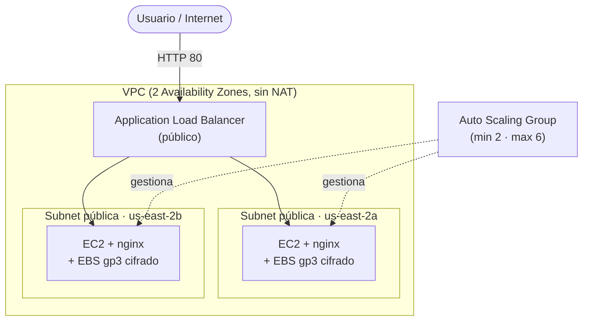

# Arquitectura — Aplicación Web de Alta Demanda

Infraestructura en AWS (us-east-2) definida con AWS CDK en TypeScript.

---

## 1. Diagrama de arquitectura

---

## 2. Componentes

| Componente | Servicio AWS | Responsabilidad | Decisiones de diseño |
|---|---|---|---|
| Red | VPC | Aislar la infraestructura | 2 AZs, solo subnets públicas /24, Internet Gateway, `natGateways: 0` para evitar el costo por hora |
| Cómputo | EC2 | Servir la app con nginx | t3.micro, Amazon Linux 2023, Launch Template, user-data del reto, IMDSv2 obligatorio |
| Escalado | Auto Scaling Group | Mantener 2 a 6 instancias | Min 2, max 6, reparte entre las 2 AZs |
| Balanceo | ALB | Repartir tráfico | Listener HTTP 80, target group al ASG, health check en `/health` cada 15 s, 3 fallos para unhealthy |
| Almacenamiento | EBS | Disco de cada instancia | gp3 de 8 GB cifrado, `deleteOnTermination: true` para no dejar volúmenes huérfanos |
| Permisos | IAM | Acceso mínimo de las EC2 | Rol solo con `AmazonSSMManagedInstanceCore` (Session Manager, sin SSH) |
| Seguridad | Security Groups | Controlar quién habla con quién | SG del ALB abierto a internet; SG de las EC2 solo desde el SG del ALB |

---

## 3. Seguridad y acceso

- **ALB:** su SG acepta 80 y 443 desde `0.0.0.0/0`.
- **EC2:** su SG tiene una sola regla de entrada, puerto 80, con origen el SG del ALB (no una IP). Se comprobó en la plantilla sintetizada: `SourceSecurityGroupId` y ningún `CidrIp`.
- **IAM:** solo `AmazonSSMManagedInstanceCore`, para depurar por Session Manager. No hay puerto 22 abierto ni key pair.
- **Sin NAT:** las instancias tienen IP pública para poder descargar nginx al arrancar. Aun así, nadie desde internet puede llegarles directo, porque el SG solo deja entrar al ALB.

_Razonamiento propio (escríbelo con tus palabras):_ ¿qué riesgo agrega tener IP pública en las EC2 y por qué el SG lo cubre?

---

## 4. Alta disponibilidad y tolerancia a fallos

- **Caída de una AZ:** hay instancias en `us-east-2a` y `us-east-2b`, y el ALB deja de enviar tráfico a las que fallan el health check. No se probó apagando una AZ completa, solo terminando una instancia.
- **Terminar una instancia a mano (16:16):** el ASG la detectó como no sana y lanzó una de reemplazo solo (`i-0830...` reemplazó a `i-0b72...`). Durante la caída, el sitio siguió respondiendo con la otra instancia, con unos segundos de respuestas 502 y timeouts hasta que el health check la sacó de rotación.
- **Health check:** el ALB consulta `/health` (nginx devuelve `ok`) cada 15 s y marca unhealthy tras 3 fallos, lo que da una ventana de detección de casi un minuto.

---

## 5. Flujo de despliegue

- Lenguaje elegido para CDK: `TypeScript`
- Despliegue: `cdk deploy` (unos 3 minutos; imprime la URL del ALB en `AlbUrl`)
- Destrucción: `cdk destroy`, y revisar la consola por recursos huérfanos

---

## 6. Boss Fight

- **Política de escalado:** target tracking por CPU, `scaleOnCpuUtilization` con objetivo de 60% de promedio del grupo. Además, una alarma `HighCpuAlarm` de CloudWatch con umbral 60%.
- **Verificación:** se saturó la CPU de las instancias con procesos `yes` desde Session Manager. La alarma de la política (`...AlarmHigh...`) pasó a ALARM y el ASG subió la capacidad deseada de 2 a 3 (16:29) y siguió lanzando instancias (16:35) sin intervención manual. Pico de instancias: Pico de instancias: la capacidad deseada subió de 2 a 3 (16:29), confirmado en el Historial de actividad. La lista de instancias terminadas muestra lanzamientos posteriores (16:35) que no quedaron en el historial que alcancé a copiar..
- **ALB como cuello de botella:** no se midió. El ALB escala automáticamente su capacidad, y el límite real del diseño es `maxCapacity: 6`. Para comprobarlo habría que mirar `RequestCount` y `TargetResponseTime` del ALB durante una carga de red real.

---

## Limitaciones y mejoras

- **HTTPS:** el SG abre el 443, pero solo hay listener en el 80. Falta un certificado (ACM) y un listener 443.
- **Persistencia:** el volumen es el raíz y se borra al terminar la instancia, así que un reemplazo pierde cualquier dato local. Para datos persistentes haría falta un volumen EBS aparte o un servicio como EFS o S3.
- **Detección de fallos:** bajar `interval` y `unhealthyThresholdCount` acortaría la ventana de 502.